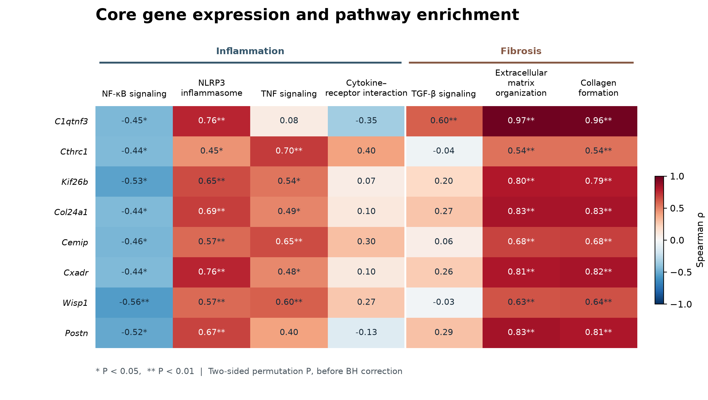

# GSE252027 阶段 02 结果

阶段 01 的 D3 对 D0 与 D7 对 D0 分别筛出 **3,385** 和 **1,663** 个基因，交集为 **1,141** 个。同向上调 960 个，同向下调 178 个。`Comp` 和 `Cilp2` 在 D3 下调、D7 上调，`Rgs7` 在 D3 上调、D7 下调。

| 图 | 怎么读 |
|---|---|
| [图 1 差异基因交集](../../../outputs/02_feature_selection/intersection_6/figures/01_candidate_intersection.png) | 左图为各集合的基因数，右图为交集内每个基因在两个相对 D0 对比中的 log₂FC。橙色菱形标记 3 个方向相反的基因。 |
| [图 2 前八基因逐文库表达](../../../outputs/02_feature_selection/intersection_6/figures/02_candidate_expression.png) | 每点是一份文库，折线连接各采样日的 VST 均值，浅色带标出 D7。各面板使用相同纵轴。 |
| [图 3 筛选稳定性](../../../outputs/02_feature_selection/intersection_6/figures/03_selection_stability.png) | 每点是一种各移除一份 D3、D7 文库的组合。左图为与全样本名单的 Jaccard 重合度，右图为实际入选基因数。 |

## 各方法在文库扰动下的表现

| 方法 | 全样本入选数 | 每次扰动入选数 | 8 次都入选的基因数 | 与全样本名单的平均 Jaccard |
|---|---:|---:|---:|---:|
| VST 均值差 | 20 | 20 | 8 | 0.556 |
| LASSO 逻辑回归 | 20 | 17–20 | 3 | 0.250 |
| Elastic Net 逻辑回归 | 20 | 20 | 2 | 0.253 |
| 随机森林 | 22 | 77–89 | 46 | 0.199 |

随机森林在只有四份文库的扰动拟合中出现大量并列重要性，导致入选数明显增加。读随机森林频率时应同时看每次入选数和 Jaccard。LASSO 和 Elastic Net 各自 8 次都入选的基因中，共有 `Cdc6` 和 `Gm13212`。

## VST 均值差排序前八

下列基因均在 8 次扰动中进入均值差绝对值前 20，且表达变化方向一致。正值表示 D7 组的 VST 均值较高，负值表示 D3 较高。

| 排名 | 基因 | D7−D3 VST 均值差 |
|---:|---|---:|
| 1 | C1qtnf3 | +3.739 |
| 2 | Exo1 | −2.982 |
| 3 | Comp | +2.868 |
| 4 | Spp1 | −2.833 |
| 5 | Birc5 | −2.819 |
| 6 | Hist1h2ae | −2.812 |
| 7 | 2810417H13Rik | −2.584 |
| 8 | Hist1h1b | −2.556 |

`Comp` 在 D3 相对 D0 下调、D7 相对 D0 上调。`Spp1` 在 D3 和 D7 均高于 D0，但 D7 的 VST 均值较 D3 低。`Timp1` 位列第 24，8 次扰动方向一致，其中 3 次进入均值差绝对值前 20。这些结果描述表达时序与固定候选池内的排序稳定性。窗口内的统计检验与候选验证仍属于后续分析。

## 三种候选池产物

| 版本 | 输入文库 × 基因 | 结果 |
|---|---:|---|
| 六文库交集 | 6 × 1,141 | [排序](../../../outputs/02_feature_selection/intersection_6/tables/feature_ranking.tsv) · [扰动明细](../../../outputs/02_feature_selection/intersection_6/tables/perturbation_selections.tsv) |
| 22 文库交集 | 22 × 1,141 | [排序](../../../outputs/02_feature_selection/intersection_22/tables/feature_ranking.tsv) · [扰动明细](../../../outputs/02_feature_selection/intersection_22/tables/perturbation_selections.tsv) · [筛选稳定性图](../../../outputs/02_feature_selection/intersection_22/figures/03_selection_stability.png) |
| 22 文库并集 | 22 × 3,907 | [排序](../../../outputs/02_feature_selection/union_22/tables/feature_ranking.tsv) · [八次扰动明细](../../../outputs/02_feature_selection/union_22/tables/perturbation_selections.tsv) · [Bootstrap 稳定性与 EFS-RA 排名](../../../outputs/02_feature_selection/union_22/figures/03_selection_stability.png) |

## 22 文库并集的 ssGSEA

热图关联并集排序前八基因与七条炎症或纤维化通路。八个基因均与细胞外基质组织和胶原形成的得分呈正相关。`C1qtnf3` 与这两条通路的相关系数分别为 **0.970、0.962**。56 个基因–通路配对中，33 个在 BH 校正后 `q < 0.05`。各时间点共同进入相关性分析。



- [逐文库 ssGSEA 得分](../../../outputs/02_feature_selection/union_22/bio_validation/tables/ssgsea_scores.tsv) · [Spearman ρ 矩阵](../../../outputs/02_feature_selection/union_22/bio_validation/tables/ssgsea_spearman_rho.tsv)
- [原始 P、BH 校正值和敏感性分析](../../../outputs/02_feature_selection/union_22/bio_validation/tables/ssgsea_correlations.tsv) · [通路基因匹配情况](../../../outputs/02_feature_selection/union_22/bio_validation/tables/ssgsea_pathway_coverage.tsv) · [运行摘要](../../../outputs/02_feature_selection/union_22/bio_validation/reports/ssgsea_summary.json)
- [分析方法和复现命令](README.md#核心基因与通路-ssgsea-相关性)

## 22 文库并集的重复交叉验证与 Bootstrap

以 4 折 × 50 次分层交叉验证的 200 个验证折汇总，LASSO 和 Elastic Net 每折入选 20 个基因。随机森林在阈值处保留并列基因，每折实际入选 20–95 个。AUPRC 用 Average Precision 计算。

| 方法 | AUROC 均值 ± SD | AUPRC 均值 ± SD | 准确率 均值 ± SD |
|---|---:|---:|---:|
| LASSO | 0.900 ± 0.171 | 0.818 ± 0.266 | 0.829 ± 0.156 |
| Elastic Net | 0.957 ± 0.108 | 0.915 ± 0.198 | 0.899 ± 0.134 |
| 随机森林 | 0.953 ± 0.132 | 0.918 ± 0.203 | 0.905 ± 0.118 |

这些指标基于固定的全队列候选池和 VST。Bootstrap 每次在 D7 与非 D7 两类中分别有放回抽 4 和 18 份文库。

1,000 次 Bootstrap 的 Jaccard 中位数依次为 VST 均值差 **0.600**、LASSO **0.212**、Elastic Net **0.212** 和随机森林 **0.175**。随机森林保留边界并列，每次实际入选 20–104 个。四种方法平均入选概率最高的三个基因为 `Mrc1`（44.15%）、`Asic3`（44.03%）和 `Mrpl52`（36.08%）。

- [逐折性能](../../../outputs/02_feature_selection/union_22/resampling/tables/cv_fold_metrics.tsv) · [性能汇总](../../../outputs/02_feature_selection/union_22/resampling/tables/cv_summary.tsv) · [CV 基因入选频率](../../../outputs/02_feature_selection/union_22/resampling/tables/cv_selection_frequency.tsv)
- [Bootstrap 基因入选概率](../../../outputs/02_feature_selection/union_22/resampling/tables/bootstrap_selection_probability.tsv) · [逐次 Jaccard](../../../outputs/02_feature_selection/union_22/resampling/tables/bootstrap_jaccard.tsv) · [Jaccard 箱线图与棒棒糖图](../../../outputs/02_feature_selection/union_22/resampling/figures/03_selection_stability.png)
- [运行摘要与随机种子](../../../outputs/02_feature_selection/union_22/resampling/reports/resampling_summary.json) · [分析方法和复现命令](README.md#重复分层交叉验证与-bootstrap)

## EFS 聚合与候选入选率

[EFS 交叉验证比较图](../../../outputs/02_feature_selection/union_22/aggregation/figures/efs_cv_auroc.png) · [九候选入选率与名次](../../../outputs/02_feature_selection/union_22/aggregation/figures/candidate_selection_frequency.png)

在固定的 3,907 基因并集候选池及阶段 01 VST 上做四折、50 次重复分层交叉验证。每个验证折含一份 D7 文库，曲线表示 200 折 AUROC 的均值。每折只用训练数据做特征排序和标准化，以同一 L2 逻辑回归（C = 1、类别平衡权重）比较四个基选择器和三个聚合策略。在 5–30 的每个特征数上均采用精确 k，排序边界并列时按 Ensembl ID 确定顺序。稀疏选择器得分不足 k 个正值时，剩余名额也依该规则填补。

聚合是对 Ding 等人三种思路的本项目实现。EFS-RA 取四种选择器绝对得分的平均降序名次，并列取平均名次。EFS-SA 取各方法 min–max 归一化后得分的平均值。EFS-IA 按基因同时进入四个排序前缀要求的最小前缀长度排序，完整计入并列块，再用 EFS-RA 打破并列。这三种实现使用原始四个选择器。统一分类器下，Elastic Net 选择器最高为 **0.99075（k = 26）**，EFS-RA 和 EFS-IA 最高均为 **0.98275（k = 25）**，EFS-SA 最高为 **0.97250（k = 23）**。空心星为历史 Elastic Net 筛选及原模型重拟合方案的 Top 20 AUROC **0.95725**。候选池和 VST 来自全队列，折间复用同一批文库。逐折标准差用于描述波动，曲线峰值供队列内比较。 [方法论文](https://doi.org/10.1016/j.patcog.2025.112809) · [均值与样本标准差](../../../outputs/02_feature_selection/union_22/aggregation/tables/efs_cv_summary.tsv) · [逐折数据](../../../outputs/02_feature_selection/union_22/aggregation/tables/efs_cv_folds.tsv) · [历史参考值](../../../outputs/02_feature_selection/union_22/resampling/tables/cv_summary.tsv)

九个待验证基因按全队列 EFS-RA 名次排列。图中各形状对应四个基选择器，深色棒棒糖表示四个 Bootstrap 入选率的算术平均。沿用阶段 02 的 Bootstrap 筛选规则，单次抽样保留 Top 20 边界并列并排除零分。`Mrc1` 的平均入选率为 44.15%，在 3,907 个候选中居首，全队列 EFS-RA 名次为第 8。 [九基因入选率](../../../outputs/02_feature_selection/union_22/aggregation/tables/candidate_frequencies.tsv) · [3,907 基因 EFS-RA 排名](../../../outputs/02_feature_selection/union_22/aggregation/tables/efs_ra_ranking.tsv)

## 冻结九候选的通路与共表达

[通路与标志物相关图](../../../outputs/02_feature_selection/union_22/bio_validation/figures/candidate_biology_correlations.png)

计算九个候选基因的 VST 表达与七条通路的逐文库 ssGSEA NES 之间的 Spearman ρ。使用固定的 KEGG 和 Reactome 小鼠基因集。计算九基因与 `Nlrp3`、`Casp1`、`Il1b`、`Tgfb1`、`Smad3`、`Col1a1`、`Acta2` 的 VST 表达之间的 Spearman ρ。两图均使用 22 份文库，做 19,999 次双侧文库配对置换，每图分别对 63 个配对做 BH 校正。星号表示 q < 0.05，双星表示 q < 0.01。 [通路相关](../../../outputs/02_feature_selection/union_22/bio_validation/tables/candidate_pathway_correlations.tsv) · [逐文库 NES](../../../outputs/02_feature_selection/union_22/bio_validation/tables/candidate_pathway_scores.tsv) · [标志物相关](../../../outputs/02_feature_selection/union_22/bio_validation/tables/candidate_marker_correlations.tsv) · [逐文库表达](../../../outputs/02_feature_selection/union_22/bio_validation/tables/candidate_marker_expression.tsv)

通路面板有 35 个配对达到 q < 0.05，标志物面板有 19 个。`Mrc1` 与 ECM 组织和胶原形成分别呈正相关（ρ = 0.636 和 0.637，均为 q = 0.00589）。它与 NLRP3 炎症小体得分的相关系数为 0.470（q = 0.0516）。从评分背景移除九个候选基因后重新计算 NES，九基因的通路分类保持一致。这里合并了六个时间点，共同的时序变化可能贡献相关性。 [通路来源与原分析说明](README.md#核心基因与通路-ssgsea-相关性)

## 候选表冻结规则

[冻结候选表](../../../outputs/02_feature_selection/union_22/aggregation/tables/frozen_candidates.tsv)

清单沿用 22 文库并集的均值差排序前八基因，并加入四方法平均 Bootstrap 入选率第一的 `Mrc1`。EFS-RA 排名以全池 3,907 个基因为分母。四列入选率采用 0–1 比例。正相关且 BH q < 0.05 的 ssGSEA 配对决定通路分类。炎症和纤维化两组均有符合条件的配对标为“双通路”。按此规则，八个原候选为“双通路”，`Mrc1` 为“纤维化”。外部验证可直接读取 `基因符号` 和 `基因ID` 两列。

```text
SHA-256  7f7254627a79c5db2c664cf073122089d1ee46c9c1b16eec4921b036245fdb5b
```

