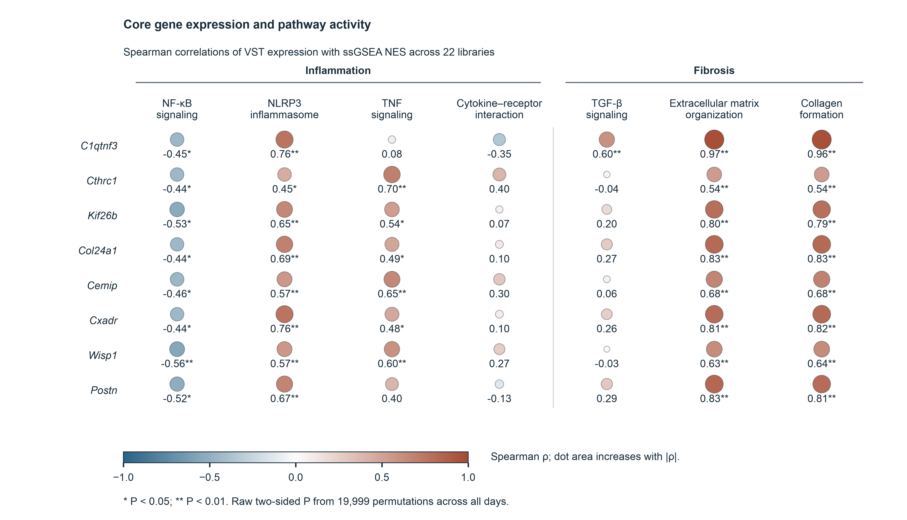

# 阶段 02 结果

| 版本 | 输入文库 × 基因 | 结果 |
|---|---:|---|
| 六文库交集 | 6 × 1,141 | [排序](intersection_6/tables/feature_ranking.tsv) · [扰动明细](intersection_6/tables/perturbation_selections.tsv) · [图表解读](../../experiments/02_feature_selection/results.md) |
| 22 文库交集 | 22 × 1,141 | [排序](intersection_22/tables/feature_ranking.tsv) · [扰动明细](intersection_22/tables/perturbation_selections.tsv) · [筛选稳定性图](intersection_22/figures/03_selection_stability.png) |
| 22 文库并集 | 22 × 3,907 | [排序](union_22/tables/feature_ranking.tsv) · [八次扰动图](union_22/figures/03_selection_stability.png) · [Bootstrap 稳定性图](union_22/resampling/figures/03_selection_stability.png) |

## 22 文库并集的 ssGSEA

热图关联并集排序前八基因与七条炎症或纤维化通路。八个基因均与细胞外基质组织和胶原形成的得分呈正相关。`C1qtnf3` 与这两条通路的相关系数分别为 **0.970、0.962**。56 个基因–通路配对中，33 个在 BH 校正后 `q < 0.05`。各时间点共同进入相关性分析。

- [逐文库 ssGSEA 得分](union_22/tables/ssgsea_scores.tsv) · [Spearman ρ 矩阵](union_22/tables/ssgsea_spearman_rho.tsv)
- [原始 P、BH 校正值和敏感性分析](union_22/tables/ssgsea_correlations.tsv) · [通路基因匹配情况](union_22/tables/ssgsea_pathway_coverage.tsv) · [运行摘要](union_22/reports/ssgsea_summary.json)
- [分析方法和复现命令](../../experiments/02_feature_selection/README.md#核心基因与通路-ssgsea-相关性)

## 22 文库并集的重复交叉验证与 Bootstrap

以 4 折 × 50 次分层交叉验证的 200 个验证折汇总，LASSO 和 Elastic Net 每折入选 20 个基因。随机森林在阈值处保留并列基因，每折实际入选 20–95 个。AUPRC 用 Average Precision 计算。

| 方法 | AUROC 均值 ± SD | AUPRC 均值 ± SD | 准确率 均值 ± SD |
|---|---:|---:|---:|
| LASSO | 0.900 ± 0.171 | 0.818 ± 0.266 | 0.829 ± 0.156 |
| Elastic Net | 0.957 ± 0.108 | 0.915 ± 0.198 | 0.899 ± 0.134 |
| 随机森林 | 0.953 ± 0.132 | 0.918 ± 0.203 | 0.905 ± 0.118 |

这些指标基于固定的全队列候选池和 VST。Bootstrap 每次在 D7 与非 D7 两类中分别有放回抽 4 和 18 份文库。

1,000 次 Bootstrap 的 Jaccard 中位数依次为 VST 均值差 **0.600**、LASSO **0.212**、Elastic Net **0.212** 和随机森林 **0.175**。随机森林保留边界并列，每次实际入选 20–104 个。四种方法平均入选概率最高的三个基因为 `Mrc1`（44.15%）、`Asic3`（44.03%）和 `Mrpl52`（36.08%）。

- [逐折性能](union_22/resampling/tables/cv_fold_metrics.tsv) · [性能汇总](union_22/resampling/tables/cv_summary.tsv) · [CV 基因入选频率](union_22/resampling/tables/cv_selection_frequency.tsv)
- [Bootstrap 基因入选概率](union_22/resampling/tables/bootstrap_selection_probability.tsv) · [逐次 Jaccard](union_22/resampling/tables/bootstrap_jaccard.tsv) · [Jaccard 箱线图与棒棒糖图](union_22/resampling/figures/03_selection_stability.png)
- [运行摘要与随机种子](union_22/resampling/reports/resampling_summary.json) · [分析方法和复现命令](../../experiments/02_feature_selection/README.md#重复分层交叉验证与-bootstrap)
